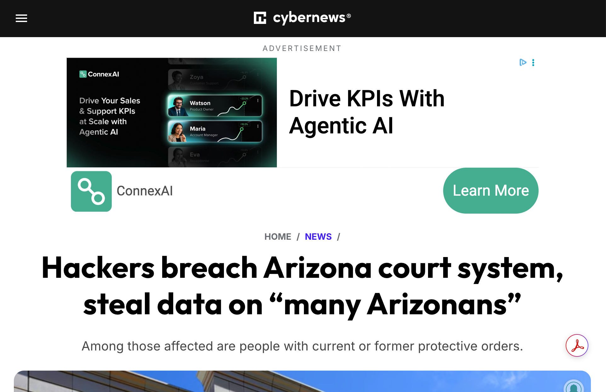
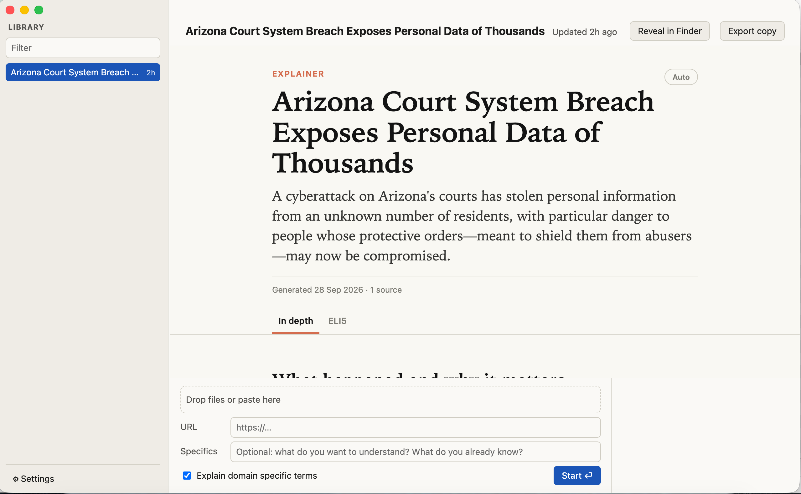
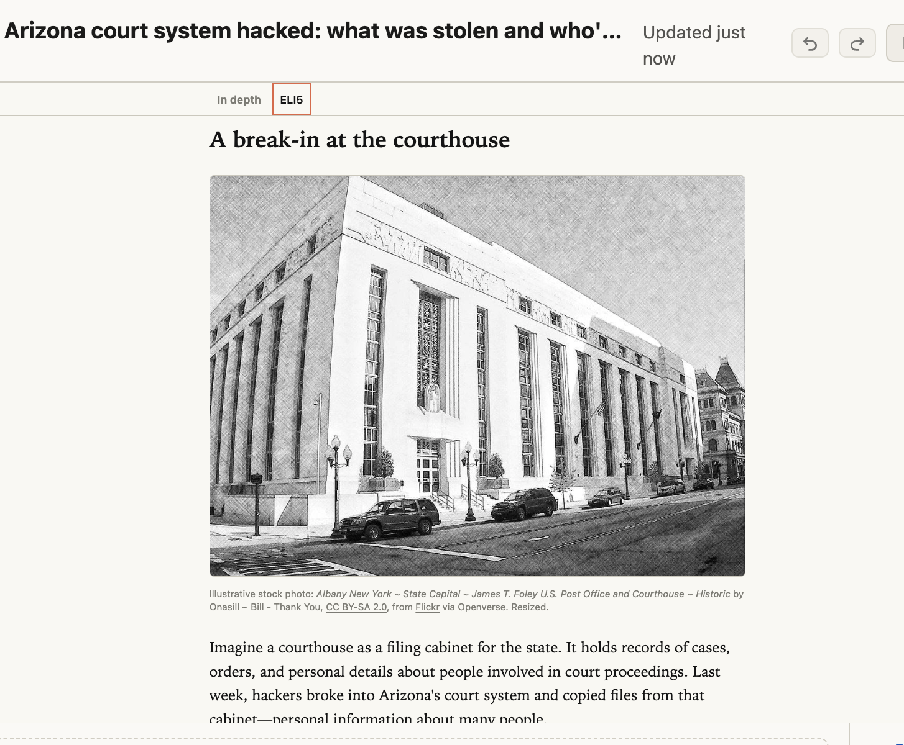
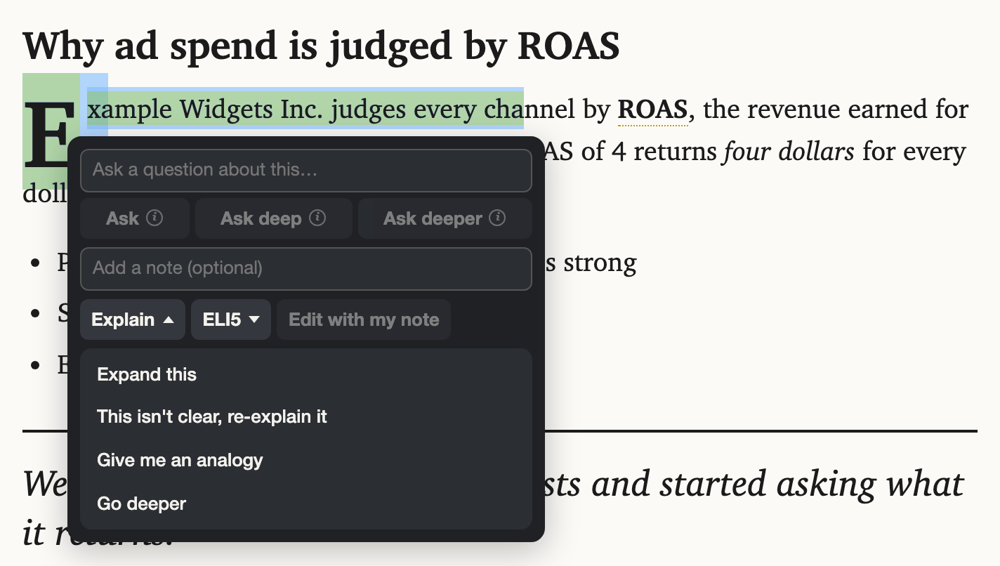
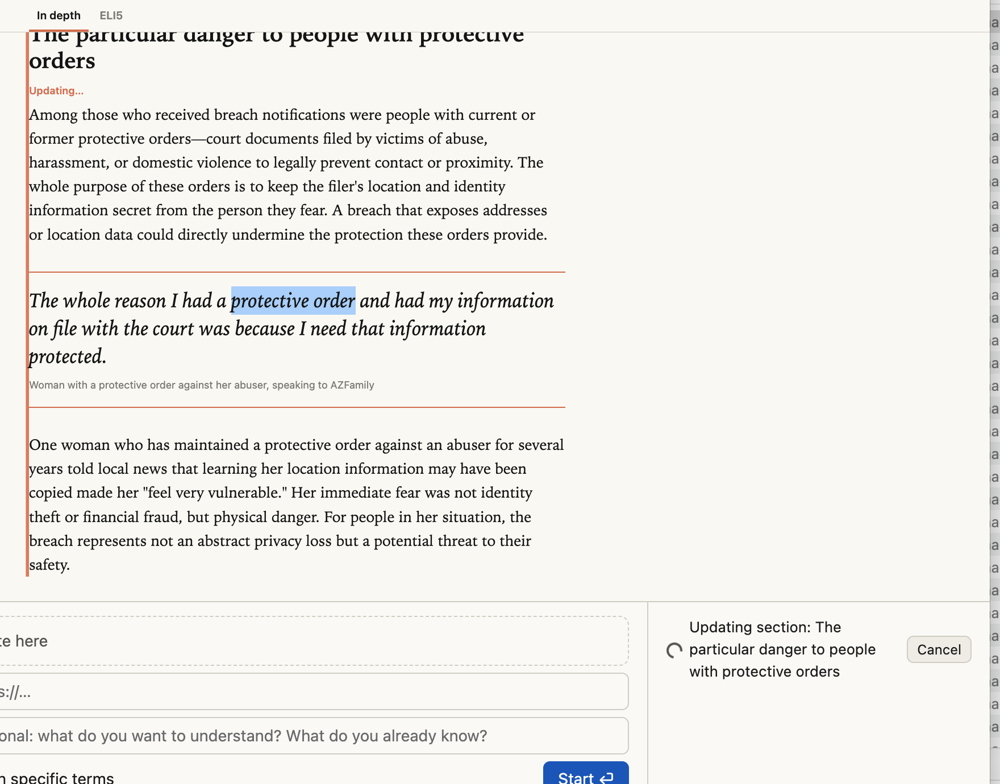
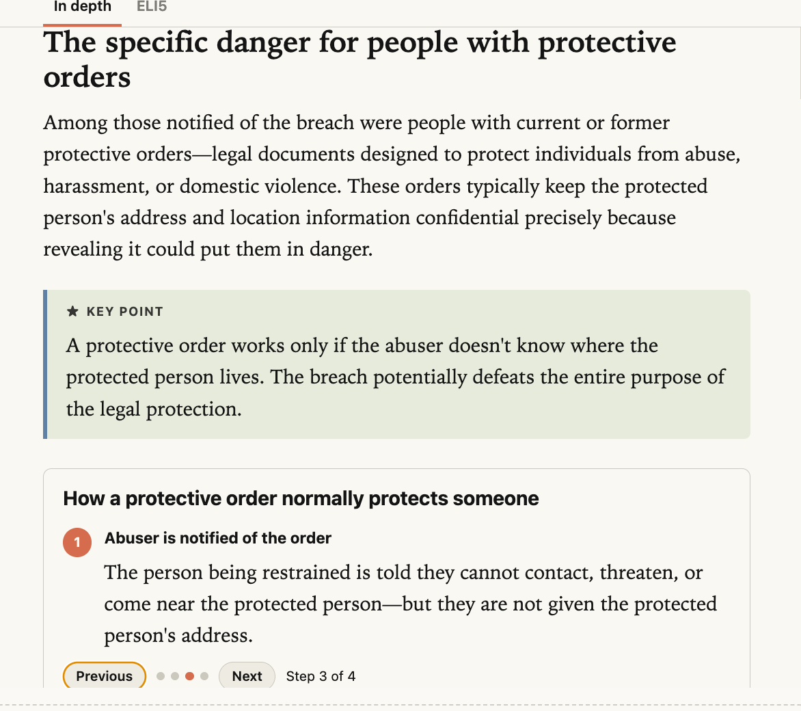
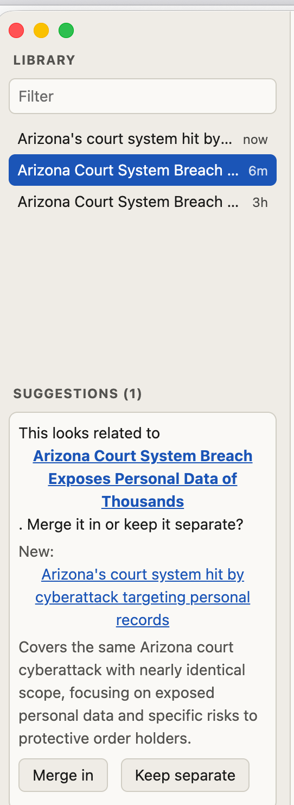
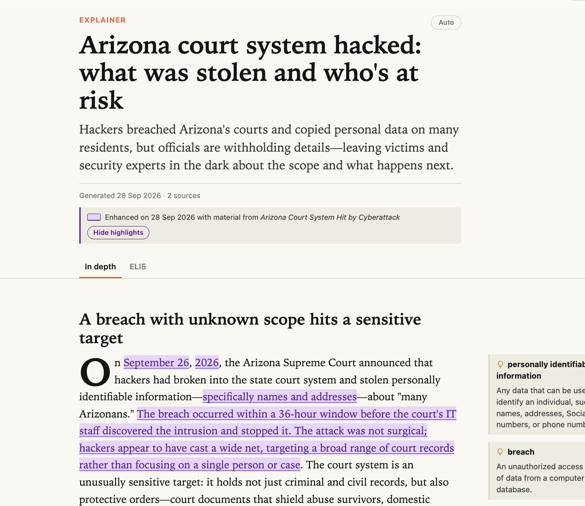
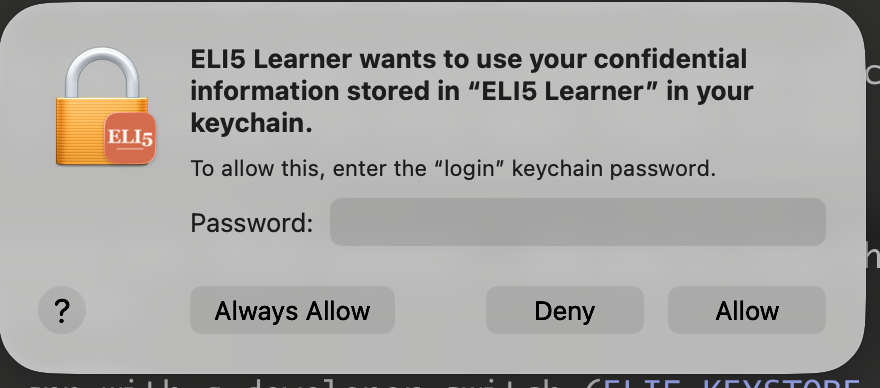

# ELI5 Learner

macOS app that turns decks, docs, PDFs, screenshots and URLs into interactive HTML explainers: an in-depth WSJ-style view, an ELI5 view and an ASD-STE100 (Simplified Technical English) view, with AI-designed animations, refinable section by section.

> **Status:** v1 is feature-complete (milestones M0 to M4): generation, interactive reading, the library, local publishing, completion notifications, and test, CI and packaging hardening. The optional v2 Android companion and personal sync (M5) are built. Since then: the ASD-STE100 tab, AI-designed sandboxed animations, the WSJ Five-Box In depth and picture-first ELI5 prompts, prompt sets in `config/prompts/`, and rebuild as a new version (a developer tool). Builds are unsigned.
> Full requirements: [spec/ELI5 Learner Product Requirements Document.md](spec/ELI5%20Learner%20Product%20Requirements%20Document.md)

## Download

**Latest release: [v0.5.0](https://github.com/knail1/eli5-learner/releases/tag/v0.5.0)** ·
[all releases](https://github.com/knail1/eli5-learner/releases) ·
[always the newest](https://github.com/knail1/eli5-learner/releases/latest)

| Platform | Download |
| --- | --- |
| Mac (Apple silicon, unsigned) | [`ELI5.Learner-0.5.0-arm64.dmg`](https://github.com/knail1/eli5-learner/releases/download/v0.5.0/ELI5.Learner-0.5.0-arm64.dmg) |
| Android (sideload companion) | [`eli5-learner-0.5.0.apk`](https://github.com/knail1/eli5-learner/releases/download/v0.5.0/eli5-learner-0.5.0.apk) |

- **Mac:** open the dmg and drag the app to Applications. The build is unsigned, so on first launch
  macOS may block it: open **System Settings > Privacy & Security** and click **Open Anyway**. Then add
  a Claude (default) or ChatGPT (OpenAI) API key in **Settings > AI**. To build it yourself, see
  [Packaging (macOS)](#packaging-macos).
- **Android:** install it with `adb install -r` or open it on the phone and allow "Install unknown
  apps". It reads exported documents offline right away. Syncing with the Mac through your own Google
  Drive needs the one-time setup in [android/SETUP.md](android/SETUP.md) (including turning on the
  Google Drive API); it has been verified end to end against a real Drive. This APK is signed with the
  project owner's release key, so Google sign-in in it only works with the owner's Google Cloud project.
  Forks build and sign their own (see [android/README.md](android/README.md)).

### What's new in v0.5.0

- **Ask deep and Ask deeper.** Next to **Ask** (Enter: answers from the section and the sections
  around it), two deeper ways to ask about a selected passage:
  - **Ask deep** (Cmd+Enter) also reads every tab and the original source text the document was
    written from. The app now keeps that extracted text
    next to each document, locally only; it is never put in the document, synced or published.
  - **Ask deeper** (Cmd+Shift+Enter) reads all of that first, then searches the web (at most three
    searches), then uses the AI's general knowledge. Anything from outside the document is marked in
    the answer ("From the web, …", "In general, …"), the badge says how far the answer went, and the
    web pages it used are listed under it as plain text (no links). A web search costs about $0.01 on
    top of the tokens, and the search queries go to your AI provider's search; see
    [docs/privacy](https://knail1.github.io/eli5-learner/privacy/).

  Each Ask button shows a small ⓘ and explains itself when you hover or tab to it. Answers land in an
  answer box inside the section, appear in History as their own version, and can be undone.
- **Android: Share.** Share a document from the reader or a Library row's menu; the recipient gets the
  `.html` file to open in any browser.

### What's new in v0.4.0

- **ASD-STE100 tab.** A third view that restates the In depth content in Simplified Technical English
  (short sentences, one meaning per word, active voice), reusing the same charts and animations. A hint
  in the tab explains what it is.
- **AI-designed animations.** When motion or a slider makes an idea clearer, the model writes a small
  interactive animation for *that* topic. It runs in a locked-down sandbox (no network, no access to the
  page or the app) with a still poster for print, Markdown and no-JS readers.
- **WSJ Five-Box In depth** with Dona Wong chart rules: takeaway titles, few series, honest axes, values
  in order, annotations, one high-contrast palette across every theme. Broken charts are fixed in code
  instead of costing another model call.
- **Simpler, more visual ELI5** with one self-critique pass that is only accepted when it keeps the
  facts and adds clarity.
- **Prompt sets in `config/prompts/`.** Every prompt is a file; `default` is the new set and `wsj-v1`
  keeps the original In depth and ELI5 prompts so you can compare. See
  [config/prompts/README.md](config/prompts/README.md).
- **Rebuild as a new version** (developer tool): regenerate existing documents with new prompts; the
  previous version stays one click away in History.
- **Android** shows everything the desktop makes: the third tab, the animations and the new palette.
- **Sync** gives a clear message when the Google Drive API is turned off in your Cloud project.

Earlier releases: [v0.4.0](https://github.com/knail1/eli5-learner/releases/tag/v0.4.0) (ASD-STE100
tab, AI-designed animations, WSJ Five-Box), [v0.3.0](https://github.com/knail1/eli5-learner/releases/tag/v0.3.0) (personal sync,
Android companion), [v0.2.0](https://github.com/knail1/eli5-learner/releases/tag/v0.2.0).

## What it does

Drop in source material, optionally type a few clarifying specifics, press Start (⌘⏎), and walk away. ELI5 Learner builds one self-contained `index.html` learning document with three views:

- **In depth.** Wall Street Journal-grade explanatory writing, with charts, diagrams, annotated figures, pull quotes and interactive animations. An optional in-context glossary explains jargon and acronyms in the right margin, next to where each one first appears.
- **ELI5.** The same material, rebuilt from scratch for comprehension, in plain words. It doesn't follow the structure of the source.
- **ASD-STE100.** The in-depth content restated in Simplified Technical English: short sentences, one instruction each, one meaning per word, active voice. It reuses the in-depth charts and diagrams and adds no facts.

The document opens in the app's viewer and in any browser.

### From a web page to an explainer

Start from a link. This article on cybernews.com blocks automated downloads: a plain HTTP request,
such as `curl` or any scripted fetcher, gets **403 Forbidden**, even when it pretends to be a
browser.



ELI5 Learner still gets it. When a plain fetch is refused or comes back empty, the app loads the page
in a **hidden Chromium window**, the browser engine that already ships inside the Electron app. The page renders
exactly as it would in your browser, and the app reads the article from the rendered page. There's
no extra browser to install, and no login.

Paste the link, press Start, and a few minutes later the explainer is in your Library:



The ELI5 tab rebuilds the same material in plain words, with analogies, simple diagrams and real open-licensed photos, each credited:



## Features

- **A WSJ-style feature, not a summary.** The In depth tab follows the Wall Street Journal "Five-Box"
  formula: a lede on one concrete case from your material (never invented people, quotes or
  numbers), a nut graf with the thesis, sections that open with their takeaway, one "boring but
  important" section with the background and caveats, and a kicker. Charts follow the WSJ graphics
  rules after Dona M. Wong (one point per chart with a takeaway title, bars from zero, at most four
  series, direct labels, the source credited). The app applies one high-contrast chart palette in
  every theme, light and dark, and fixes small chart faults itself instead of dropping the chart.
- **Picture-first ELI5, checked once.** Every ELI5 section is built around a picture (a diagram, a
  stepper, an everyday analogy, a simple chart, a photo or a simple animation), then explained in
  short, plain sentences. One critique pass then revises the draft against a rubric and an automatic
  plain-language checker; code keeps the revision only if it is no worse and adds no new numbers.
- **ASD-STE100 tab.** A third tab restates the In depth content in
  [Simplified Technical English](https://en.wikipedia.org/wiki/Simplified_Technical_English), the
  controlled writing standard from aerospace maintenance manuals. A short hint at the top of the tab
  (and on its tooltip) explains the standard. An automatic checker counts sentences that break its
  rules and triggers at most one repair. If the step fails, the document simply has two tabs.
- **AI-designed animations, in a sandbox.** When a topic has a mechanism you understand better by
  moving it (a learning rate on a loss curve, a sampler's random walk, estimates shrinking toward a
  group mean), the model writes a small interactive animation for that topic, with a slider or two
  and a live readout. There are no canned animations: each one is designed for the document it is
  in. The model's code runs in a sandboxed frame with its own strict content security policy: no
  network requests, no access to the page around it, no navigation or storage, and a trusted shell
  removes the network APIs (WebRTC included) before the model's code runs. The app also checks the
  code first and drops an animation that reaches for anything forbidden. Each animation has a still poster
  that shows without JavaScript and in print; the Markdown export carries its description and caption.
- **Fire-and-forget generation.** No modals and no mid-job questions. A source that fails is skipped and listed in the document's references. Jobs can be queued.
- **Queue links, then run.** Enter in the URL field (or Add) turns each link into a chip and starts nothing, so you can collect several first; Start (⌘⏎) sends them all. The sent links move to a dimmed *Last run* row: **Run again** re-sends them, **Use again** puts them back as chips, and your specifics stay. Clear empties the input zone. The panel above the input zone can be dragged taller.
- **Several documents at once.** Settings > Documents > *Documents generated at once* (1 to 3); waiting jobs say what they're waiting for.
- **Many inputs in one job.** Drag and drop, paste (Cmd+V) or URLs:
  - PowerPoint (slide order, bullet hierarchy and speaker notes are kept)
  - Word (headings, lists and tables are kept)
  - PDF, including scanned PDFs through vision
  - Markdown and text
  - Images and screenshots, sent straight to the model's vision input with no OCR step
  - Excel
  - Public web pages
- **Living documents.** Select any passage to open a small menu, grouped so it stays short:
  - *Ask a question about this…*: type a question and press Enter for **Ask**, Cmd+Enter for
    **Ask deep**, or Cmd+Shift+Enter for **Ask deeper** (see *Ask* below); hover or tab to a button's
    ⓘ to see what it searches
  - **Explain ▾**: *Expand this*, *Re-explain it*, *Give me an analogy*, *Go deeper*
  - **ELI5 ▾**: *Create a separate ELI5 for this section*, and *ELI5 this selection*, a focused ELI5
    tab about exactly what you selected, from one phrase to several paragraphs
  - *Edit with my note*: type a correction or instruction in the note field, and only that passage
    (and where it repeats in the section) is rewritten to follow it

  It works from the keyboard too: Cmd+. moves into the menu, the arrow keys move between the
  triggers and their items, and Esc closes a popup, then the menu. Cmd+. then Enter twice is still
  *Expand this*. The four Explain actions, and *Edit with my note*, regenerate only that section, in place. Selecting body text never picks up the
  glossary notes in the margin, and a selection inside a note stays inside it.

  

  While it works, the section is marked "Updating…" and the status line shows the job, which you can cancel:

  

  When it's done, the section is rewritten in place and nothing else in the document changes. Here,
  *Expand this* on "protective order" rebuilt the section: a plain definition of the term, a key
  point explaining why the breach matters, and a step-by-step walkthrough of how a protective order
  normally protects someone:

  
- **Ask.** A question about a passage is answered in an answer box inside that section, grounded in
  the document; the rest of the section is left exactly as it was. The viewer lands on the box with
  your question shown; afterwards the box keeps only a small "?" chip that reveals the question again.
  Several answers in one section stack, and they move with the section if it is rewritten later.
  Answer boxes are plain content: they are in exports, print, and documents opened in any browser.
  There are three Ask buttons. **Ask** answers from the section and its neighbours. **Ask deep** also
  reads every tab and a private copy of the text extracted from the document's sources, and its
  box says whether it was checked against the original sources, excerpts of them, or the tabs only.
  That copy stays inside the document's folder: it is never published or synced. Documents made
  before this feature have no copy, so Ask deep there works over their tabs only. **Ask deeper**
  reads the same material first; only when that does not answer the question does it let your AI
  provider search the web, and then fall back to the AI's general knowledge. Anything from outside
  the document is marked in the answer, the box says how far it had to go, and the web pages it used
  are listed as plain text (titles and addresses, no links).
- **Version tree.** Every change (a section action, an answer, a closed tab, a merge) is a version,
  and nothing is thrown away when you go back and change something else: that starts a branch.
  Undo / Redo (Cmd+Z / Shift+Cmd+Z) step back and forward, and Forward retraces the branch you last
  visited. The **Versions** panel (Cmd+Y, or the Versions button in the document header) shows the
  whole tree with what changed and when; click any version to open it, and the viewer lands on the
  section it changed. Older documents get the new menu the first time you open them.
  A document rebuilt with new prompts is a new version too ("Rebuilt with new prompts"); checking out
  the version before it restores the old document exactly.
- **Section ELI5 tabs.** Focused ELI5 tabs, spun off from any passage and labeled by topic. You can close them.
- **Real photos for real-world scenes.** People, places and everyday situations are shown with open-licensed stock photos (Openverse, with Wikimedia Commons as a fallback) instead of hand-drawn pictures; lists, flows and comparisons stay clean diagrams. Photos are embedded in the file, each with a credit and license marked "Illustrative stock photo". Only a few generic search words leave your Mac, and a setting turns it off.
- **Library and menu bar.** Every document is listed in a sidebar, which you can prune with folders (drag documents in), an Archive and a recoverable Trash: swipe a document left to archive it or right to trash it, with Undo. The menu bar shows the last three, and the app keeps running in the menu bar when the window is closed.
- **Find.** Cmd+F searches the open document, with a match count and Cmd+G / Shift+Cmd+G to step through matches; Option+Cmd+F filters the Library.
- **Merge suggestions.** When a new document covers the same or a related topic as one already in your
  Library, the app notices when the job finishes. It offers to merge the new material into the existing
  document to enrich it, instead of leaving two near-copies. The match doesn't have to be the same link:
  a different outlet's take on the story, or something a colleague sent that is sort of related, adds
  detail the first source didn't have. You can also do this on purpose to build one richer document from
  several sources.

  For example, after the cybernews article above, the same breach reported by FOX 10 Phoenix, with more
  on the personal records involved:

  

  When that job finishes, a suggestion waits quietly in the sidebar. It names the existing document and
  the new one and says why they match, and it never interrupts you. **Merge in** weaves the new material
  into the existing document: both the In depth and the ELI5 tab are revised in place, and new sections
  are added where they fit. Every enhancement is highlighted in its own color, a legend at the top says
  when and from what the document was enhanced (with a Hide highlights toggle), and the new sources are
  marked in the references. One Undo reverses the merge; **Keep separate** dismisses the suggestion.

  

  After **Merge in**, the document is rewritten in place, not appended to. Everything the merge added
  is highlighted in violet, and a legend under the title names the source it came from, with a
  **Hide highlights** switch. Here the FOX 10 story added the 36-hour window and the "wide net" detail
  to the opening section:

  
- **Export.** *Export copy* writes the self-contained `index.html` to your export folder; *Export Markdown* writes the same document as a `.md` file next to it, with every chart, table and diagram rendered as text.
- **Claude or ChatGPT.** Claude is the default. Settings > AI also offers ChatGPT (OpenAI, on the Responses API); pick a suggested model or type any model ID under *Custom…*.
- **Completion notifications.** A native macOS notification tells you when a document is ready. Clicking it opens the document in the app, or, if you choose, its published link in your browser.

## How it works

```
sources ──▶ resolve & extract ──▶ LLM generation ──▶ docs/<topic-slug>/index.html
 files        (file / clipboard /     (Claude or          + meta.json
 clipboard     public URL)             OpenAI)            + docs/catalog.json
 URLs                                                       │
                                                            ▼
                                                  merge-suggestion check
```

- **URL fetching:** first a plain HTTP fetch with Readability-style extraction. If that comes back empty, looks like a bot challenge, or is refused (403 or 429), the app renders the page in a hidden Electron window. There's no Puppeteer and no extra Chromium download.
- **Stable section IDs:** every section of every tab has a stable ID, so one section can be regenerated without touching the rest of the file.
- **Local storage:** documents live in the app's `docs/` folder. That folder is git-ignored because it's built from your own source material.

## Architecture: swappable seams

Every external capability sits behind an interface, so other backends can be swapped in without restructuring the app:

| Interface | Ships with | Documented stubs |
| --- | --- | --- |
| `LLMProvider` | Claude API (default), OpenAI Responses API (ChatGPT) | AWS Bedrock |
| `SourceResolver` | Local files, clipboard, public URLs | MCP-brokered authenticated sources |
| `Publisher` | Local directory (copy and Markdown) | Organization cloud drive, GitHub Pages |

The public build needs nothing but an API key: no accounts, no logins and no other keyed services. The optional stock photo search is anonymous.

## Configuration

- LLM provider (Claude or OpenAI) and model name
- Prompt set (no UI, see [Prompt sets](#prompt-sets))
- API key, stored in the macOS Keychain
- Default setting for "Explain domain-specific terms"
- "Use stock photos for real-world scenes" (on by default)
- Notifications: on or off, what a click opens (the document in the app, or its published link in your browser), a test button, and a shortcut to the macOS notification settings

## Use it on your phone (optional)

> **Built (v2, milestone M5); sync unverified against a real Google Drive.** The Android companion
> and personal sync are specified in [spec/tech/16-android-companion.md](spec/tech/16-android-companion.md).
> The local reader works with no setup. Sync needs your own Google Cloud project
> ([android/SETUP.md](android/SETUP.md)). The G1 smoke test passed against a real Google Drive in November 2026: sign-in on the Mac and on a Pixel, desktop push, primary claim, and the phone pulling and listing the library. Phone jobs (Ask) and conflict paths are still unverified against a real Drive.

An optional Android app reads your learnings offline and sends links, photos and files from the
phone's share sheet to your Mac, which does the generating. It is sideloaded (no Play Store).

- **Without any Google setup:** install the APK and import exported `index.html` files. All three tabs
  (In depth, ELI5, ASD-STE100), the glossary, charts, the theme and the sandboxed animations work offline.
- **With sync (off by default):** connect both apps to a hidden app folder in your own Google Drive.
  Your library shows up on the phone, and "Send to my Mac" queues a job that your Mac runs when it is
  awake. Your API key never leaves the Mac. Sync copies your learnings (not your sources or notes),
  and Google can read them.

You bring your own Google Cloud OAuth clients; nothing secret is in the repository or the APK. The
step-by-step guide, from installing the Android toolchain to connecting both apps, is
[android/SETUP.md](android/SETUP.md). How the Android project is laid out, built, signed and
sideloaded (plus the on-device checklist) is in [android/README.md](android/README.md).

## Not in v1

- Logins or authenticated sources (v2 adds one opt-in sign-in, for the personal sync above)
- Audio input or speech to text
- Cloud publishing (cloud drive, GitHub, Google Drive) and NotebookLM

## Roadmap

- A side-by-side diff between two versions
- Google Drive publishing and NotebookLM linking

## Getting started

Requires macOS and Node.js 22.12 or newer.

```sh
npm install          # also downloads the Electron binary
npm run dev          # run the app with hot reload (development profile, separate from real data)
```

All milestones (M0 to M4 in [spec/tech/README.md](spec/tech/README.md)) are built: generation,
interactive reading, the library, local publishing, and the test, CI and packaging hardening.

| Command | What it does |
| --- | --- |
| `npm run build` | Production build of the public edition into `out/` |
| `npm run typecheck` / `npm run lint` | Strict TypeScript and ESLint, including module boundary rules |
| `npm test` | Unit, integration, renderer, eval-runner, perf and public contract tests (offline; network access fails the test) |
| `npm run test:e2e` | Test build, then Playwright: the app end to end, startup time, and the cross-browser suite |
| `npm run test:crossbrowser` | Golden documents in Chromium and WebKit (smoke, accessibility, zero network); no app build |
| `npm run test:visual` | Test build, then screenshot comparisons: golden documents in Chromium and WebKit, the app in Electron; contact sheet at `test-results/visual/index.html` |
| `npm run test:visual:update` | Rewrites the visual baselines in `test/visual/__screenshots__/`; review the contact sheet before committing them |
| `npm run check:spec` | Validates the spec's private-hook markers |
| `npm run check:hygiene -- --out out --package` | Public-repo hygiene over tracked files and a package build in `out/` |
| `npm run check:licenses` | Runtime dependency license allow list |
| `npm run check:editions` | Builds the edition cells (fixture overlay, missing overlay, public stubs) and checks them |
| `npm run package` | Unsigned `.dmg` via electron-builder (`npm run package:arm64` on Apple silicon) |
| `npm run test:package` | Checks the packaged app in `release/` (bundle contents, fuses, launch smoke) |

### Packaging (macOS)

The quickest way to build the app for your Mac:

```sh
scripts/build.sh            # installs dependencies if needed, then builds the unsigned .app and .dmg
scripts/build.sh --check    # run typecheck, lint and unit tests first
scripts/build.sh --clean --open   # clean build, then open the app
```

The same steps by hand:

```sh
npm run package:arm64      # clean build, then an unsigned arm64 dmg
npm run test:package       # optional: check the packaged app
```

The dmg lands in `release/` (for example `release/ELI5 Learner-0.3.0-arm64.dmg`). Build one dmg
per architecture on (or with `npm install --cpu=<arch>` for) that architecture; on an Intel Mac use
`CSC_IDENTITY_AUTO_DISCOVERY=false npx electron-builder --mac dmg --x64` after `npm run build`.
Signing and notarization run only when credentials are set (`CSC_LINK`/`CSC_KEY_PASSWORD`, and
`APPLE_API_KEY`/`APPLE_API_KEY_ID`/`APPLE_API_ISSUER` or
`APPLE_ID`/`APPLE_APP_SPECIFIC_PASSWORD`/`APPLE_TEAM_ID`). Without them the app is unsigned
(ad-hoc signed on Apple silicon).

**Opening an unsigned build.** macOS blocks apps that are not notarized. After the first launch
attempt, open System Settings > Privacy & Security and click **Open Anyway** next to the ELI5
Learner message. Or, after copying the app to Applications, run
`xattr -dr com.apple.quarantine "/Applications/ELI5 Learner.app"`.

### API key and the macOS Keychain

Add your Claude or OpenAI key in **Settings → AI**. The app stores it only in the macOS Keychain, as a
password item with service **"ELI5 Learner"** (account `llm.claude.apiKey` or `llm.openai.apiKey`).
It is never written to `settings.json` or the logs, and the Settings screen can save or clear it but
never read it back. You can see the item in the Keychain Access app by searching for "ELI5 Learner".

When the app first reads the key, macOS asks for permission:



Click **Always Allow**. Unsigned builds get a new code identity every time they are rebuilt, so macOS
asks again after each rebuild; a build signed with a stable identity (a Developer ID, see above)
asks only once. **Deny** is safe: the app then cannot use the key and asks you to add one in Settings.

### Prompt sets

Every prompt the app sends to a model is a plain Markdown file in
[`config/prompts/`](config/prompts/README.md), not TypeScript. It ships with the app as
`Resources/prompts`. `config/prompts/default/` holds every prompt and the shared fragments (chart
rules, diagram rules, animation rules and more). A **prompt set** is a sibling folder that holds only
the files it overrides; everything else comes from `default`. The repo ships `wsj-v1`, the frozen
earlier In depth and ELI5 prompts, so you can compare their old and new wording. It swaps only those
two prompts: the ASD-STE100 tab, the ELI5 critique (and their model calls) and chart normalization
still run as in `default`.

To try a set:

1. Create `config/prompts/<my-set>/` (lowercase letters, digits and dashes) and copy in only the
   prompts you want to change, for example `in-depth.md`. Keep the front matter and bump `version`.
2. Run it in development with `ELI5_PROMPT_SET=<my-set> npm run dev`. The variable is ignored by an
   installed app, which loads prompts only from its own `Resources/prompts`: a new set reaches it only
   after you rebuild and reinstall the app (`scripts/build.sh`). To select a set without the variable,
   quit the app, set `"llm": { "promptSet": "<my-set>" }` in its `settings.json` (there is no UI for
   it), then relaunch; the setting is read once at startup. To go back, remove the setting.
3. Generate a document. Its `meta.json` records `generation.promptSet`, the prompt tags (for example
   `in-depth@5~<my-set>`) and a digest of every prompt and fragment used.

A well-formed set name with no matching folder, or a set with broken files, is logged as
`prompts.set-invalid` and the app uses `default`. A `settings.json` value that is not a valid name
(anything but lowercase letters, digits and dashes, at most 40) fails the settings check instead: the
app logs `settings.reset` and rewrites the value to `default`. `npm test`
lints every prompt (front matter, variables, the untrusted-content wording); after changing
`default`, update the rendered-request golden with `npm run test:update-goldens`.

**Rebuilding documents with new prompts** is a developer tool for now: the real-run driver in
[`scripts/real-run/`](scripts/real-run/README.md) (rebuild mode) regenerates existing documents from
their source files and saves each as a new version, with a dry run and a fake-LLM rehearsal that cost
nothing, and a hard spending cap for the real run.

### Generation-quality evals

`npm run eval -- --provider claude --model <id>` runs the rubric evals in `test/evals/` against a
real provider, scored by an LLM judge (see [test/evals/README.md](test/evals/README.md)). They cost
money and need the network, so they never run in `npm test`. Keys come only from
`ELI5_EVAL_API_KEY_CLAUDE` / `ELI5_EVAL_API_KEY_OPENAI`, and `ELI5_EVAL_MAX_USD` (default 10) caps
the spend. `npm run eval:calibrate` checks the judge against the hand-scored documents.

### Continuous integration

`.github/workflows/ci.yml` runs on every push to `main` and every pull request, on macOS runners:
static checks (types, lint, format, spec hooks, dependency audit and licenses), the Vitest projects
with coverage floors, a public build, the e2e and cross-browser suites, the edition cells, the
hygiene gate, and on `main` an unsigned dmg. The evals run nightly and on manual dispatch only; they
use the `ANTHROPIC_API_KEY` / `OPENAI_API_KEY` repository secrets and skip when those are unset. The
optional `ELI5_HYGIENE_DENYLIST` secret adds the term deny-list step to the hygiene gate.

In development, generated documents go to the gitignored `.library/` folder, never to `docs/`
(the public GitHub Pages source). Settings live in `~/Library/Application Support/ELI5 Learner (dev)/`.

## License

[MIT](LICENSE) © 2026 Omer Ansari
